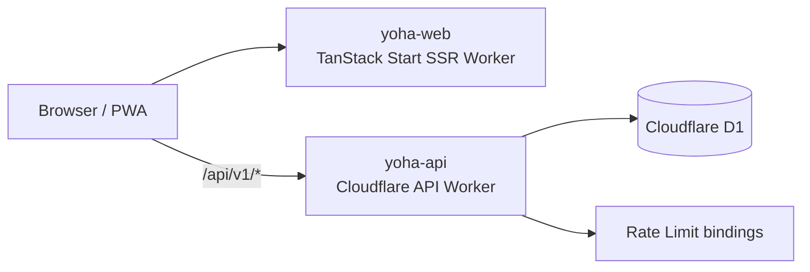

# FLYSTIC

FLYSTIC is a campus plastic-collection platform. Students bring plastic to collection stations, confirm transactions with QR codes, earn points, and choose whether to use those points for rewards or community fundraising. Station administrators can create transactions, monitor collected plastic, record transfers, and view reports.

The interface supports Vietnamese, English, and Korean, works on desktop and mobile devices, and can be installed as a Progressive Web App (PWA).

## Features

### Students

- Register, sign in, and view accumulated points and contributed plastic weight.
- Scan QR codes with the camera or enter transaction codes manually.
- Allocate points to community fundraising or the rewards balance.
- View transaction history, weekly/all-time leaderboards, and environmental impact.
- Explore collection points on the campus map and read sorting guides for PET, HDPE, PP, LDPE, and PS.

### Station administrators

- Create transactions from plastic type, weight, and cleanliness; the system generates QR codes that expire after five minutes.
- Monitor, filter, and cancel pending transactions.
- View station capacity, campaign metrics, and reports by plastic type and quality.
- Record the transfer of all plastic currently stored at a station.
- Export report data as CSV from the interface.

## Architecture



The project contains two independent Cloudflare Workers:

- `yoha-web`: the TanStack Start application, which performs server-side rendering and serves static/PWA assets; configured in `wrangler.jsonc`.
- `yoha-api`: the REST API for authentication, QR transactions, points, stations, and reports; configured in `backend/wrangler.jsonc`.
- `yoha`: the D1 database bound to the API Worker as `DB`.

When `VITE_API_BASE_URL` is not defined, the frontend switches to demo mode and stores state in `localStorage`. When the variable is set, authentication, transactions, points, and reports are loaded from the API and D1.

> The current product name is **FLYSTIC**. Legacy technical names such as `yoha-web`, `yoha-api`, the `yoha` database, and `yoha:*` storage keys remain in use for compatibility with existing infrastructure and data.

## Technology stack

- React 19, TypeScript, and Vite 7
- TanStack Start, TanStack Router, and TanStack Query
- Tailwind CSS 4, Radix UI, and Lucide React
- Cloudflare Workers, Wrangler, and D1
- PWA manifest, service worker, and a minimal offline page
- Camera QR scanning with `qr-scanner` and QR generation with `qrcode.react`

## Quick start

### Requirements

- Node.js and npm, or Bun
- A Cloudflare account when using remote D1 or deploying to production

The repository contains both `package-lock.json` and `bun.lock`. Choose one package manager and use it consistently. The examples below use npm; with Bun, replace `npm install` with `bun install` and `npm run <script>` with `bun run <script>`.

### Frontend demo mode

This mode does not require the backend or a Cloudflare account:

```bash
npm install
npm run dev
```

Open `http://localhost:5173`. Do not create `.env.local`; the application will store the demo session and transaction data in the browser. This mode is intended for UI development and must not be used for real data.

### Full-stack local mode

1. Install dependencies:

   ```bash
   npm install
   ```

2. Create the local API secrets file:

   ```bash
   cp backend/.dev.vars.example backend/.dev.vars
   ```

   Replace every placeholder in `backend/.dev.vars` with a separate, sufficiently long value. Do not commit this file.

3. Initialize local D1 with the migrations:

   ```bash
   npm run api:db:local
   ```

4. Start the API Worker in the first terminal:

   ```bash
   npm run api:dev
   ```

   By default, Wrangler serves the API at `http://localhost:8787`.

5. Create `.env.local` in the repository root:

   ```dotenv
   VITE_API_BASE_URL=http://localhost:8787
   ```

6. Start the frontend in a second terminal:

   ```bash
   npm run dev
   ```

Verify the API with `GET http://localhost:8787/api/v1/health`.

## Environment variables and bindings

### Frontend

| Name                | Required | Description                                                                                    |
| ------------------- | -------- | ---------------------------------------------------------------------------------------------- |
| `VITE_API_BASE_URL` | No       | Public API Worker base URL without `/api/v1`. Leave unset to use the `localStorage` demo mode. |

Every variable prefixed with `VITE_` is exposed in the browser bundle. Never store secrets in frontend environment variables.

### API Worker

| Name/binding          | Type               | Description                                                                                  |
| --------------------- | ------------------ | -------------------------------------------------------------------------------------------- |
| `AUTH_SECRET`         | Secret             | Signs and verifies session tokens.                                                           |
| `PASSWORD_PEPPER`     | Secret             | Pepper used when hashing passwords; do not change it casually after users have been created. |
| `ADMIN_INVITE_CODE`   | Secret             | Invitation code required to create a station administrator account.                          |
| `ALLOWED_ORIGIN`      | Variable           | Comma-separated list of origins allowed to call the API.                                     |
| `DB`                  | D1 binding         | The `yoha` database.                                                                         |
| `AUTH_GLOBAL_LIMIT`   | Rate Limit binding | Limits the total number of registration and sign-in requests.                                |
| `AUTH_IDENTITY_LIMIT` | Rate Limit binding | Limits authentication requests by email/identity.                                            |

Local values are stored in `backend/.dev.vars`. Create production secrets with `wrangler secret put`.

## Scripts

| Command                 | Purpose                                                   |
| ----------------------- | --------------------------------------------------------- |
| `npm run dev`           | Start the frontend development server.                    |
| `npm run build`         | Build the TanStack Start frontend for Cloudflare Workers. |
| `npm run build:dev`     | Build the frontend in Vite development mode.              |
| `npm run preview`       | Preview the frontend production build.                    |
| `npm run lint`          | Run ESLint and Prettier checks.                           |
| `npm run format`        | Apply Prettier formatting.                                |
| `npm run api:dev`       | Start the API Worker with local D1.                       |
| `npm run api:db:local`  | Apply D1 migrations to the local database.                |
| `npm run api:db:remote` | Apply D1 migrations to the production database.           |
| `npm run api:deploy`    | Deploy the API Worker.                                    |

## Application routes

TanStack Router generates routes from filenames in `src/routes/`. Do not edit `src/routeTree.gen.ts` manually.

| URL                   | Access        | Purpose                                              |
| --------------------- | ------------- | ---------------------------------------------------- |
| `/`                   | Public        | FLYSTIC landing page.                                |
| `/auth`               | Public        | Student or station administrator registration/login. |
| `/app/map`            | Public        | Collection-point map.                                |
| `/app`                | Student       | Dashboard and recent activity.                       |
| `/app/scan`           | Student       | Scan/enter a QR code and confirm a transaction.      |
| `/app/rewards`        | Student       | Community fundraising and rewards.                   |
| `/app/leaderboard`    | Student       | Leaderboard.                                         |
| `/app/guide`          | Student       | Plastic identification and sorting guide.            |
| `/app/profile`        | Student       | Profile, history, and settings.                      |
| `/admin`              | Administrator | Station dashboard.                                   |
| `/admin/new`          | Administrator | Create a transaction and QR code.                    |
| `/admin/transactions` | Administrator | Transaction list.                                    |
| `/admin/reports`      | Administrator | Reports, station transfers, and CSV export.          |

## REST API

Every endpoint uses the `/api/v1` prefix.

| Method | Endpoint                               | Access        | Purpose                                                     |
| ------ | -------------------------------------- | ------------- | ----------------------------------------------------------- |
| `GET`  | `/health`                              | Public        | Check API health.                                           |
| `GET`  | `/stations`                            | Public        | List stations and current capacity.                         |
| `GET`  | `/leaderboard?period=week\|all`        | Public        | Return the weekly or all-time leaderboard.                  |
| `POST` | `/auth/register`                       | Public        | Create an account; administrators need a valid invite code. |
| `POST` | `/auth/login`                          | Public        | Sign in and receive a token.                                |
| `GET`  | `/me`                                  | Authenticated | Return the current profile.                                 |
| `GET`  | `/snapshot`                            | Authenticated | Return profile, station, transaction, and dashboard data.   |
| `POST` | `/admin/transactions`                  | Administrator | Create a QR transaction.                                    |
| `POST` | `/admin/transactions/:id/cancel`       | Administrator | Cancel a pending transaction owned by the current admin.    |
| `GET`  | `/transactions/:token`                 | Authenticated | Read a transaction using its QR token.                      |
| `POST` | `/transactions/:token/confirm`         | Student       | Confirm a transaction and point allocation destination.     |
| `POST` | `/admin/stations/:stationId/transfers` | Administrator | Record the transfer of plastic stored at the station.       |

Send the session token in the request header:

```http
Authorization: Bearer <token>
```

## Database

The migrations in `backend/migrations/` create and update these tables:

- `users`: student/admin accounts, points, and total contributed weight.
- `stations`: collection stations, coordinates, and capacity.
- `transactions`: QR codes, plastic items, status, and confirmation timestamps.
- `point_ledger`: an immutable point record for each transaction.
- `station_transfers`: plastic-transfer history.
- `audit_events`: audit records for important business operations.
- `auth_throttles`: failed sign-in counts and lockout timestamps.

The fictional dataset for screenshots and product demos is stored in `backend/seeds/june-july-2026-demo/`. It uses only `example.invalid` email addresses and does not represent real people. Read the seed directory's README before loading it.

## Project structure

```text
.
├── backend/
│   ├── migrations/              # D1 schema and upgrades
│   ├── scripts/                 # Demo dataset generator
│   ├── seeds/                   # Fictional demo SQL
│   ├── src/worker.ts            # REST API Worker
│   └── wrangler.jsonc           # D1, rate limits, CORS, and API route
├── exports/                     # Exported brand assets
├── public/
│   ├── icons/                   # PWA icons
│   ├── manifest.webmanifest
│   ├── offline.html
│   └── sw.js                    # Navigation offline fallback
├── src/
│   ├── assets/                  # Map, event, and plastic-guide images
│   ├── components/              # Feature components and UI primitives
│   ├── hooks/                   # Shared React hooks
│   ├── lib/
│   │   ├── yoha-api.ts          # API client and DTOs
│   │   └── yoha-store.tsx       # State, i18n, and local/remote adapter
│   ├── routes/                  # File-based routes
│   ├── routeTree.gen.ts         # Generated file; do not edit manually
│   ├── server.ts                # SSR Worker entry and error fallback
│   ├── start.ts                 # TanStack Start middleware
│   └── styles.css               # Global Tailwind theme
├── package.json
├── vite.config.ts
└── wrangler.jsonc               # Frontend Worker configuration
```

## Cloudflare deployment

### API Worker and D1

1. Sign in and create the database if the infrastructure does not already exist:

   ```bash
   npx wrangler login
   npx wrangler d1 create yoha --binding DB --update-config --config backend/wrangler.jsonc
   ```

2. Create the three production secrets:

   ```bash
   npx wrangler secret put AUTH_SECRET --config backend/wrangler.jsonc
   npx wrangler secret put ADMIN_INVITE_CODE --config backend/wrangler.jsonc
   npx wrangler secret put PASSWORD_PEPPER --config backend/wrangler.jsonc
   ```

3. Update `ALLOWED_ORIGIN` and the route/domain in `backend/wrangler.jsonc`, then migrate and deploy:

   ```bash
   npm run api:db:remote
   npm run api:deploy
   ```

### Frontend Worker

1. Set `VITE_API_BASE_URL` to the API's HTTPS URL in the build environment.
2. Verify the domain/route in `wrangler.jsonc`.
3. Build and deploy:

   ```bash
   npm run build
   npx wrangler deploy
   ```

The current configuration uses `yoha.io.vn` for the frontend and `api.yoha.io.vn` for the API. When changing the frontend domain, update the API's `ALLOWED_ORIGIN` value as well.

## Security and operations

- Passwords are hashed with PBKDF2-SHA-256, a per-user salt, and a `PASSWORD_PEPPER` stored only by the Worker.
- QR tokens are stored in D1 only as SHA-256 hashes, expire after five minutes, and can be confirmed only once.
- The API recalculates points and weight; in remote mode, the client does not decide the awarded points.
- Authentication uses rate limiting and applies a 15-minute lockout after five failed attempts within a 15-minute window.
- Distribute `ADMIN_INVITE_CODE` only for short-lived onboarding. Rotate it after provisioning administrator accounts.
- Do not remove or change `PASSWORD_PEPPER` without a password-reset process for every user.
- The service worker currently caches only the manifest and offline navigation page; transaction workflows are not fully available offline.

## Verification before submitting changes

```bash
npm run lint
npm run build
```

After backend changes, also start the local API, apply migrations to local D1, and verify at least the administrator creates QR → student confirms → station report updates workflow.

## Android packaging

The application is currently a TanStack Start SSR/PWA, so the recommended packaging approach is a Trusted Web Activity (TWA) connected to the deployed HTTPS domain. The backend continues to run separately on Cloudflare; never embed D1 data or secrets in the APK/AAB. Before release, configure `/.well-known/assetlinks.json`, generate an Android App Bundle, complete closed testing, and submit the required Data safety information in Play Console.
